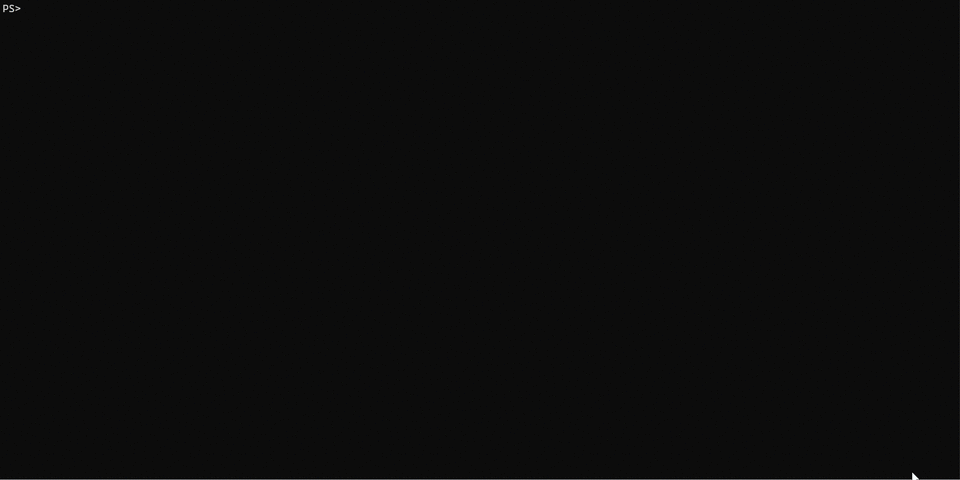
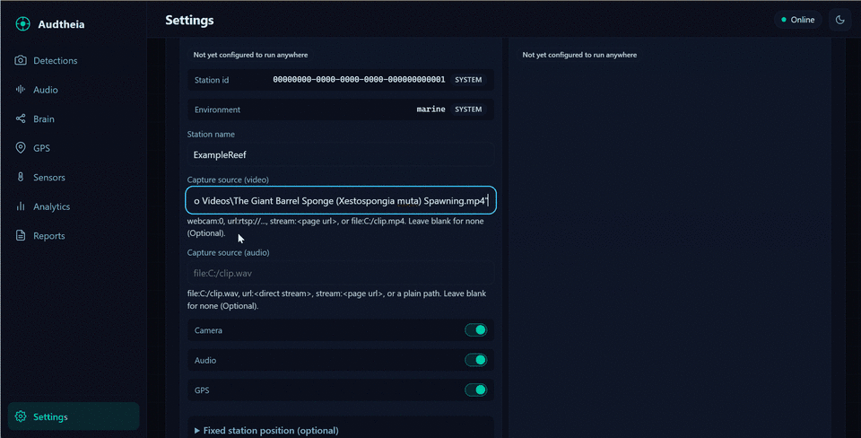
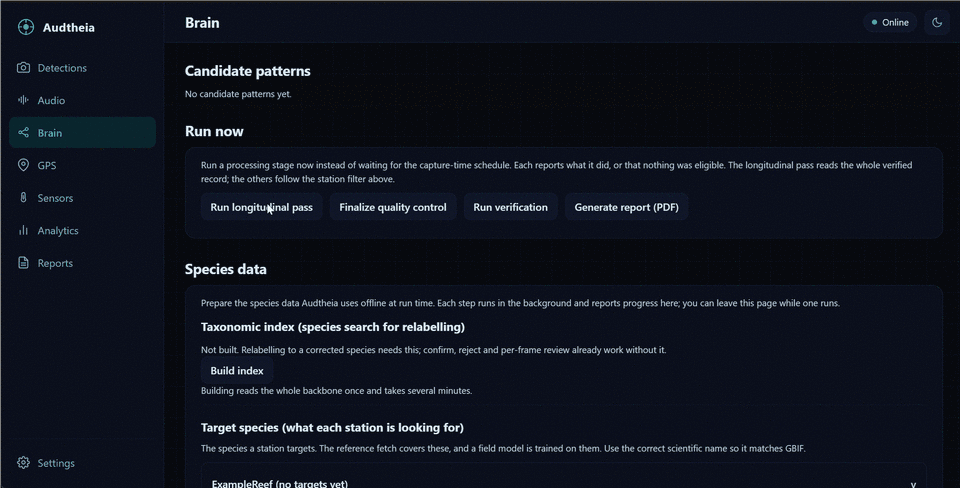
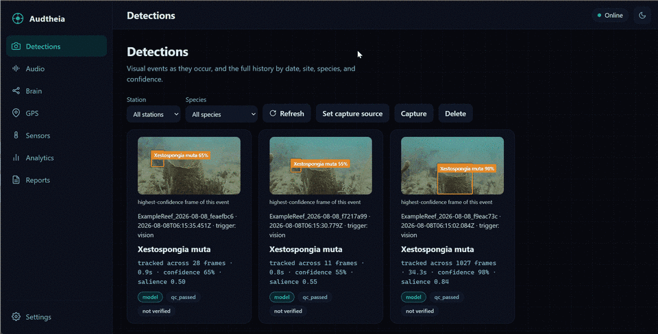

# Audtheia V2 Setup Guide

This guide takes you from a fresh clone to a running Audtheia application, then through desktop capture with no hardware, connecting a Raspberry Pi field station, preparing species reference data, and using the interface. No programming experience is required. For the project overview, see the [main README](../README.md).

## Getting started

By the end of this section your computer will be running the Audtheia application, ready to connect a field station or to capture directly with no hardware. No programming experience is required.

<div align="center">
  
  <p><em>From a fresh clone to the Audtheia desktop app: clone, run setup once, and launch.</em></p>
</div>

### Before you begin

You need two things installed:

- **Python 3.11 or newer.** Raspberry Pi OS Bookworm already includes it. On Windows and macOS, install it from [python.org](https://www.python.org/downloads/) if you do not have it.
- **Git**, to download the project.

### Step 1: Download Audtheia

Open a terminal (on Windows, use Command Prompt or PowerShell) and run:

```
git clone https://github.com/AudtheiaOfficial/audtheia-v2.git
cd audtheia-v2
```

### Step 2: Run setup once

Setup creates an isolated environment, installs the pinned dependencies, creates the local database, prepares a credentials file, and downloads the base models. It is safe to run more than once.

```
./scripts/setup.sh          # Linux, macOS, Raspberry Pi OS
scripts\setup.bat           # Windows
```

When it finishes, it prints a short summary, including any model it could not download automatically and where to place it by hand.

### Step 3: Launch the application

Audtheia runs as a desktop application in its own window. The first time only, add the window component; after that the app launcher opens it directly:

```
scripts\start-app.bat --install-window        # Windows
./scripts/start-app.sh --install-window        # Linux, macOS
```

From then on, launch it with the app launcher alone (or just double-click it):

```
scripts\start-app.bat          # Windows
./scripts/start-app.command    # macOS (or double-click it in Finder)
./scripts/start-app.sh         # Linux
```

This opens Audtheia in its own window using your system's built-in web view (Edge WebView2 on Windows, WebKit on macOS), so it looks and behaves like a normal application rather than a browser tab.

**Prefer a browser tab instead?** The plain launcher serves the same interface and offers to open it in your browser at `http://127.0.0.1:8000`:

```
scripts\start.bat           # Windows
./scripts/start.command     # macOS
./scripts/start.sh          # Linux
```

Either way, the launcher starts the local server and waits until it answers; there is no terminal interaction after this.

> **Note:** launching the app opens the interface. To actually capture and analyze on your own computer with no field hardware, see [Running the desktop hardware-free mode](#running-the-desktop-hardware-free-mode) below. You can start it right from the Detections panel, or with a single command.

## Running the desktop hardware-free mode

You do not need any field hardware to use Audtheia. In this mode your computer watches an ordinary video source and runs the whole pipeline itself, detecting, verifying, analyzing, and reporting, exactly as a field station would.

<div align="center">
  
  <p><em>Set a video source, start capture, and watch labeled detections appear, each with its confidence, salience, and provenance.</em></p>
</div>

Everything is ready out of the box. The reference setup already includes a detection model and its species names, so there are only two things to do: pick what to watch, and start.

### Step 1: Choose what to watch

Tell a station where its video comes from. You can set this in the app under **Detections, Set capture source**, or in the settings file under `capture.source.video`. Any of these work:

- `webcam:0` for a connected camera (use `webcam:1` for a second one);
- `url:rtsp://...` or `url:https://...m3u8` for a direct camera or streaming address;
- `stream:https://...` for a public web-page live stream, such as a wildlife camera page, found automatically;
- `file:/path/to/clip.mp4` for a video file on your computer.

The reference setup ships a station already set to `webcam:0`, so you can start right away.

### Step 2: Start capturing

Open **Detections**, set your source, then press **Capture** and **Start**. Detections appear below as they happen, each with its frame and species label, exactly as in the demo above. Press Start again to stop. That is all it takes.

---

**Two optional extras.** The reference model recognizes marine sponges; to detect other species, add your own model (the [custom models guide](custom-models.md) covers it). And if you would rather run everything unattended from a terminal instead of pressing Start, one command does it all, capture, verification, the longitudinal analysis, reports, and the interface:

```
scripts\run-desktop.bat     # Windows
./scripts/run-desktop.sh    # Linux, macOS, Raspberry Pi OS
```

Add `--once` to run through a single video file and then stop.

## Connecting a field station

A field station is a Raspberry Pi 5 with the AI HAT+ 2, a camera, and the sensors your site needs. Building one is described in the [hardware guide](hardware.md), and preparing its detection model in the [custom models guide](custom-models.md).

Once the hardware is assembled:

1. Flash the Pi with Raspberry Pi OS (64-bit, Bookworm or newer) using Raspberry Pi Imager, with SSH and Wi-Fi enabled, and boot it on the same network as your computer.
2. From your computer, provision it over the network:

   ```
   ./scripts/connect-pi.sh --station-id <id> --host <pi-address> --user <pi-user>
   connect-pi.bat --station-id <id> --host <pi-address> --user <pi-user>
   ```

   Add `--dry-run` to preview every action without contacting a Pi.

This sends the code, the station's configuration and models, and its network settings to the Pi, sets up its environment, initializes its local store, brings up its Wi-Fi hotspot for local access, and installs the service that keeps it running across reboots. From then on the station operates independently, capturing to its own local store. In the field with no internet, it broadcasts its own network named after the station.

Bringing a station's captured record across to the desktop uses the append-only station-to-desktop sync, and it is implemented. The desktop pulls a reachable station over SSH: the station exports its unconfirmed rows, the desktop imports them and fetches the frames and clips they reference, and the station marks them confirmed, so a sync can never overwrite a desktop-owned value and an interrupted pull is safe to resume. It runs automatically whenever a connected station is reachable, and a **Sync now** control in Settings triggers a pull on demand. The SSH and scp transport awaits validation on real hardware (see [Project status](../README.md#project-status)); the sync logic is covered by tests. Once a station's records are on the desktop, you review everything, the detections, audio, sensors, GPS, and reports, in the desktop application.

A station-local live interface served over that hotspot, so you can open the station's own address from a phone or laptop in the field and watch live detections and sensor readings, is part of the field-station work now entering on-device validation (see [Project status](../README.md#project-status)). Today the desktop application is where a station's record is reviewed.

## Setting up species names and conservation status

Two one-time steps prepare the species data Audtheia uses offline at run time. Both are guided actions in the interface, under **Brain, Species data**, so neither needs a command line; each runs in the background and shows its progress, and you can leave the page while one runs.

<div align="center">
  
  <p><em>Building the offline taxonomic index, then fetching each species' GBIF and IUCN reference data, from the Brain panel.</em></p>
</div>

- **Build the taxonomic index.** Relabelling a detection to a corrected species searches a prebuilt index of the shipped GBIF backbone. Building it reads the backbone once and takes several minutes. Confirming a detection, rejecting it, and marking individual frames accurate or inaccurate need no index and work without it; only relabelling to a searched species depends on it.
- **Fetch reference data.** For each of your stations' target species, Audtheia fetches the GBIF taxonomic match, the GBIF global occurrence count, and, when a token is present, the IUCN Red List category, and caches them locally with the fetch date stamped on every dependent record. New captures then carry a snapshot date, so the "Model and data versions" panel discloses how current its taxonomy and status data is.

Only one credential matters, and only for one field. GBIF naming and the occurrence count are public and need no account, so the IUCN token is the only credential that changes anything: it adds the Red List conservation status. Put an IUCN token in `config/secrets.json` (setup created it from a template) to fill that field; without it, everything else still fetches and the status is left blank and reported as such.

Both steps are also available from the command line for an unattended setup: `python scripts/build_gbif_index.py` builds the index, and `./scripts/fetch-species-data.sh` (or `scripts\fetch-species-data.bat`) fetches the reference data.

## Using the interface

The interface is a browser-based application served locally by the device, with all assets bundled so it loads with no internet.

<div align="center">
  
  <p><em>A quick tour of the sidebar: detections, audio, the Brain, the map, analytics, reports, and settings.</em></p>
</div>

The sidebar keeps things organized:

- **Detections**: the live feed and the browsable history, each observation shown as an event card with its frames, labels, audio, location, sensor readings, quality flags, and the desktop verification result.
- **Audio**: acoustic detections and playable clips, with the active acoustic model shown.
- **Brain**: three areas, the models and their accumulated memory; learning, fine-tuning, and audit logs; and reusable skills that add site-specific rules.
- **GPS**: the map of detection locations, survey paths, and site boundaries.
- **Analytics**: species richness over time, environmental trends, diversity metrics, and anomaly flags surfaced as candidate patterns.
- **Reports**: scheduled and on-demand PDF and CSV reports, every value labeled by its provenance and its data source disclosed.
- **Settings**: color scheme, station management, sensor and capture configuration, the capture source, model paths, schedules, credentials, and a built-in guide.

## Configuration

Everything that varies between deployments lives in `config/settings.json`, never in code: the stations and their sensors, the model paths, the capture tuning, the desktop capture source, the report and longitudinal-pass schedules, and the display time zone. Timestamps are always stored in coordinated universal time and localized only for display. Every setting is documented with examples in `config/README.md`.

## Troubleshooting

- **Setup stops on a package.** The message names the package and the reason. The most common cause is an older Python; Audtheia needs 3.11 or newer. Install a current Python and run setup again.
- **The generative model did not install.** This is not fatal. The desktop still runs, and the longitudinal pass still discovers and records its patterns; the language model only adds richer interpretation and can be installed later.
- **The desktop mode records no detections.** Confirm a detection model is present at the path the station's desktop model setting names, and that the capture source opens (a wrong camera index, stream address, or file path is the usual cause). The [custom models guide](custom-models.md) covers obtaining a model.
- **A field station is not reachable.** Confirm it is on the same network, that SSH was enabled when you flashed it, and that the address and user you passed are correct. Use `--dry-run` to check the steps without contacting the Pi.
- **A named time zone does not resolve on Windows.** Windows does not ship the time-zone database; install it with `pip install tzdata`, or leave the time zone set to automatic, which needs nothing.
